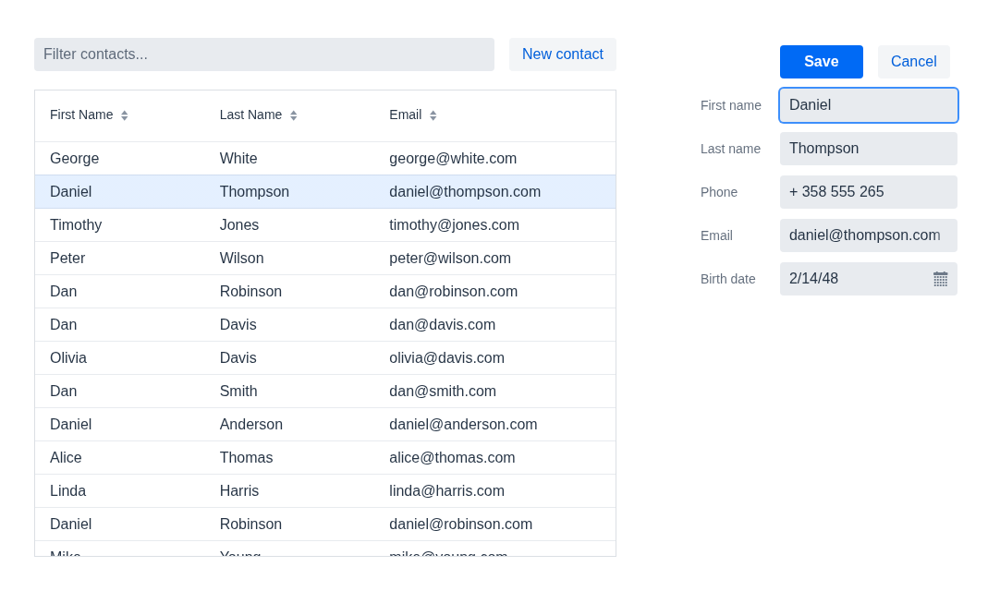

Addressbook Tutorial
====================

This tutorial teaches you some of the basic concepts in [Vaadin](https://vaadin.com) (Vaadin 25, Flow). It is meant to be
a fast read for learning how to get started - not an example on how application should be
designed. Please note this example requires Java 21 and Maven 3.9.



The contact list with a contact open in the form (Vaadin 25, Lumo theme). The hand-off document for the migration from Vaadin 8 is [docs/handoff.md](docs/handoff.md) ([PDF](docs/handoff.pdf)).


Running the example from the command line
-------------------
```
$ mvn jetty:run
```

Open [http://localhost:8080/](http://localhost:8080/). This runs Vaadin in development (debug) mode. Vaadin usage statistics are turned off for every `mvn jetty:run` (the Jetty plugin in `pom.xml` sets `vaadin.devmode.usageStatistics.enabled=false`).

To build and run it in production mode, the way it is deployed:
```
$ mvn package          # target/addressbook-2.0.war, a production build
$ mvn jetty:run-war    # builds the war and runs it on Jetty
```

Vaadin 25 decides production mode at build time: the war is built with the production frontend bundle and without the optional `vaadin-dev` dependency. No Vaadin licence key is needed; the app uses only the free `vaadin-core` components.

Running the tests
-------------------
```
$ mvn test
```

JUnit 6 unit tests of the in-memory backend (`src/test/java`): `ContactService` stores and returns copies, and the 100 demo contacts match the original app's (`src/test/resources/.../demo-contacts.csv`). Maven runs them in UTC and en-US whatever the host's settings (surefire `argLine` in `pom.xml`). `mvn package` runs them too, and so does `mvn jetty:run-war`, which builds the war first: a failing test stops the app from starting. `mvn jetty:run` compiles the tests but does not run them.

### End-to-end tests

```
$ mvn jetty:run-war                                   # or env/up.sh, or ci/start-app.sh 8080; production mode
$ mvn verify -Pe2e -Dapp.url=http://localhost:8080    # in a second terminal
```

Playwright for Java (1.63.0) tests in `src/test/java/.../e2e`, run by Maven failsafe with the `e2e` profile: one class per workflow (`AB01BrowseContactsIT` ... `AB11ConcurrentEditIT`; AB07 is not covered yet). They drive the running app in headless Chromium (en-US, UTC, 1400 x 900) at the URL in `app.url`, and never start the app themselves. Without `-Pe2e` they are compiled but not run.

- **Fresh app:** the contacts are in memory and shared by every session, and the tests change them. Start (or restart, e.g. `env/reset.sh`) the app right before a run; a second run against the same app fails.
- **Fixed order:** the classes run in the order of their `@Order` (AB01, AB02, AB03, AB06, AB11, AB05, AB10, AB04, AB08, AB09). Tests that change data come after the tests whose checks they would break. Where an earlier test's change still shows, the check is relative and the class says so: AB10 compares with the list as it was when it started, and AB04, AB08 and AB09 check that the contact that was first before their save is now below the new one. A single class (`-Dit.test=AB04AddContactIT`) also passes against a fresh app.
- **One app per run:** the classes run one after the other against one app. Running them in parallel on several app copies is not set up.
- **Browsers:** Playwright downloads its Chromium on the first run. To use browsers you already have, set `PLAYWRIGHT_BROWSERS_PATH` to their folder and `PLAYWRIGHT_SKIP_BROWSER_DOWNLOAD=1`.
- **Failures** name the workflow step; screenshots of the open pages go to `target/e2e-failures/`, the reports to `target/failsafe-reports/`.

CI runs them after the smoke check, against the app the job started: see [ci/README.md](ci/README.md).

Reproducible environment
-------------------
With Docker, one command builds and starts a copy of the app in a known state (seed contacts, Vaadin production mode):
```
$ env/up.sh
```

Open [http://localhost:8080/](http://localhost:8080/). `env/reset.sh` returns it to the seed contacts and `env/down.sh` stops it. Ports, names and several copies side by side: see [env/README.md](env/README.md).


Importing in an IDE
--------------------
The project is a plain Maven war project (`pom.xml`, Java 21). Clone this repository, open or import it as a Maven project in IntelliJ IDEA, Eclipse or NetBeans with a JDK 21, and run the Maven goal `jetty:run` (development mode) or `jetty:run-war` (production mode) from the IDE's Maven tool window; the project shows there as "Vaadin Addressbook example". Then open [http://localhost:8080/](http://localhost:8080/). These IDE steps are generic and were not tested with a particular IDE version; the command-line steps above are the tested ones.

To use an IDE's own server adapter instead, choose a Jakarta EE 11 (Servlet 6.1) container, such as Jetty 12.1 (ee11, as used by `mvn jetty:run`). Older servers (Servlet 3 or 4, `javax.servlet`, for example GlassFish 4 or Tomcat 8 and 9) cannot run this version of the app.
